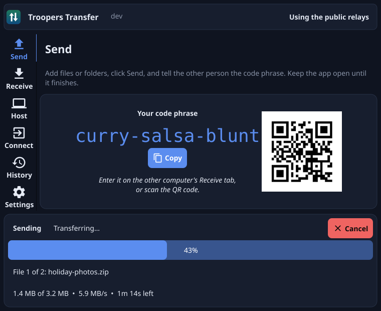
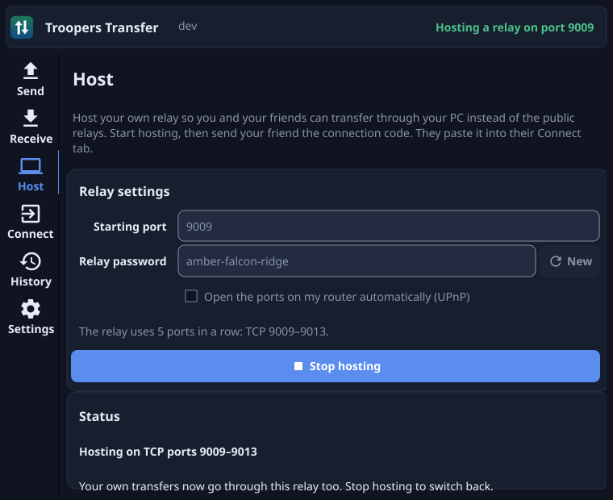
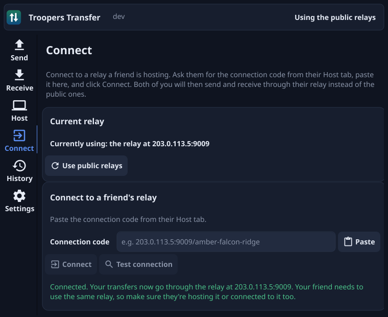
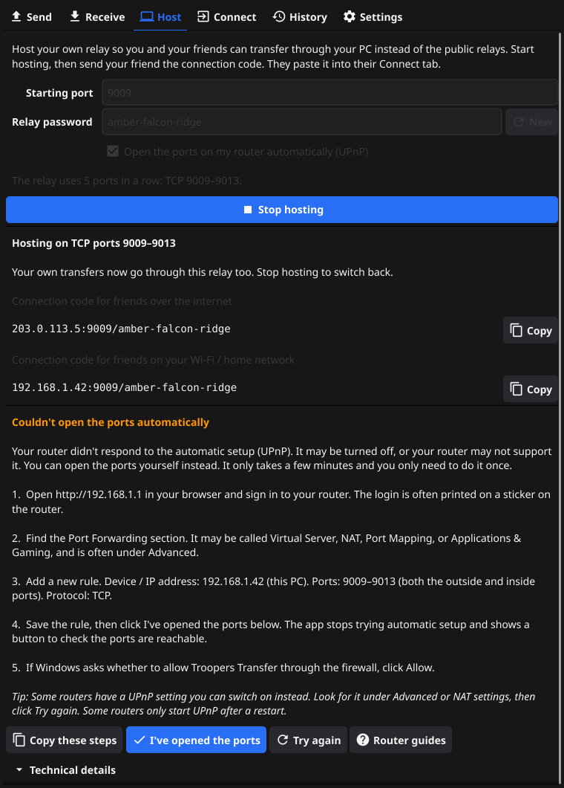
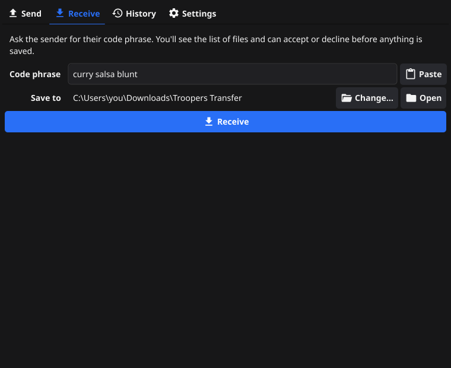
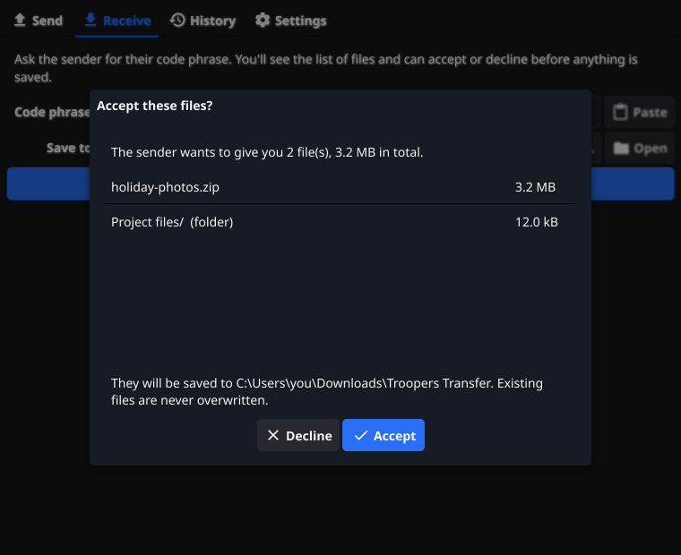
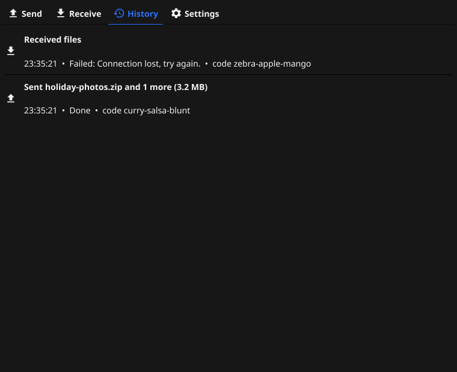
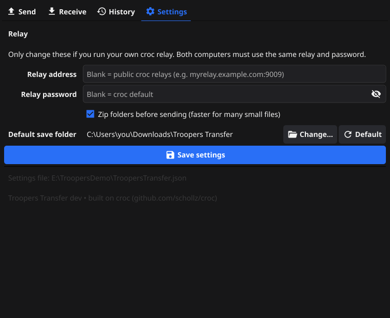

<p align="center">
  
</p>

<h1 align="center">Troopers Transfer</h1>

<p align="center">
  <strong>Send files and folders between any two computers with a three-word code. No accounts, no installer, no cloud storage.</strong>
</p>

<p align="center">
  
  
  
  
  
</p>

---

Troopers Transfer is a portable, point-and-click desktop app for sending files
between computers. It wraps [croc](https://github.com/schollz/croc), the
end-to-end encrypted file transfer tool, in a friendly GUI that anyone can
use. It's a **single executable**: no installer, no admin rights, and no
registry writes, so it runs happily from a USB stick.

It can also **host its own relay**: one click turns your PC into the server
your friends transfer through, with the router ports opened for you, and
plain-English, step-by-step help when your router won't cooperate.

<p align="center">
  
</p>

## Table of contents

- [What's new in 1.3](#whats-new-in-11)
- [Features](#features)
- [Screenshots](#screenshots)
- [Download](#download)
- [Quick start](#quick-start)
  - [Send a file](#send-a-file)
  - [Host a relay for your friends](#host-a-relay-for-your-friends)
- [Using it](#using-it)
  - [First launch on Windows (SmartScreen)](#first-launch-on-windows-smartscreen)
  - [Sending](#sending)
  - [Receiving](#receiving)
  - [Hosting a relay for friends](#hosting-a-relay-for-friends)
  - [Opening the ports by hand](#opening-the-ports-by-hand)
  - [Connecting to a friend's relay](#connecting-to-a-friends-relay)
  - [History](#history)
  - [Settings](#settings)
- [Security and privacy](#security-and-privacy)
- [Self-hosting a croc relay](#self-hosting-a-croc-relay)
- [Troubleshooting](#troubleshooting)
- [Building from source](#building-from-source)
- [Developer CLI](#developer-cli)
- [Project layout](#project-layout)
- [How the croc integration works](#how-the-croc-integration-works)
- [How relay hosting works](#how-relay-hosting-works)
- [Safety design](#safety-design)
- [Tests](#tests)
- [Continuous integration and releases](#continuous-integration-and-releases)
- [Contributing](#contributing)
- [License and credits](#license-and-credits)

## What's new in 1.3

- **Host tab.** Run a croc relay on your own PC with one click. The app opens
  the ports on your router automatically (UPnP, with NAT-PMP as a fallback),
  gives you a connection code to send to friends, and closes the ports again
  when you stop.
- **Plain-English router help.** If the ports can't be opened, the app works
  out *why*: UPnP switched off, a refusal, a port clash, carrier-grade NAT, a
  second router, a VPN, or another program using the ports. It then tells you
  exactly what to do, with step-by-step port-forwarding instructions that
  already contain your router's address, your PC's IP address and the ports.
- **Connect tab.** Paste a friend's connection code and click **Connect**.
  The app checks the relay answers, the password is right and every port can
  be reached before switching to it.
- **Linux CI fixed.** The Linux build now installs the Wayland headers that
  GLFW 3.4 needs.

**1.1.1 – 1.1.3**

- **Finds more routers.** As well as the usual UPnP search, the app now asks
  your router directly at its own address, and sends its multicast search
  through the network adapter that actually reaches the router. On Windows PCs
  with WSL, Hyper-V or a VPN, the usual search often went out through a
  virtual adapter and never reached the router. Searches also run in parallel,
  so a router that answers is found in a moment instead of timing out.
- **Better help when you forward ports by hand.** When the router doesn't
  answer UPnP, the steps now end with **I've opened the ports**. It switches
  off automatic setup and restarts hosting. **Check my ports online** then
  opens a port checker so you can confirm friends can reach you.
- **More useful technical details.** When discovery fails, they say how many
  replies came back from the router directly and by multicast, and which
  devices answered.
- **Ports freed instantly.** Stopping the relay closes its ports right away.

## Features

- **Drag and drop sending.** Drop files or folders on the window (or browse),
  click **Send**, and read the code phrase to the other person. A QR code is
  shown too.
- **Preview before receiving.** The receiver sees the file list and total size
  and chooses **Accept** or **Decline** before a single byte is written.
- **Live progress.** Progress bar, speed, time remaining, current file, and a
  **Cancel** button.
- **Plain-English errors.** "Wrong code…", "Sender closed the app…",
  "Connection lost, try again." Technical details are tucked away under an
  expander for when you need them.
- **Never overwrites.** Existing files are left alone; duplicates are saved as
  `name (1).ext`, `name (2).ext`, …
- **End-to-end encrypted.** croc uses PAKE + AES-256. Relays only see
  encrypted bytes.
- **Fast on a LAN.** When both computers are on the same network, croc
  connects them directly.
- **Your relay or the public one.** Works with croc's free public relays or
  your own self-hosted relay.
- **Host a relay in one click.** The Host tab runs a relay on your PC and
  opens the router ports automatically (UPnP / NAT-PMP). If that fails, it
  explains why and gives step-by-step manual instructions filled in for your
  network.
- **Connect with one code.** Friends paste your connection code into the
  Connect tab. It's tested before it's used, and any problem is explained.
- **Truly portable.** Settings live in a JSON file next to the exe.
- **Session history** of everything you sent and received.
- **Cross-platform.** Windows, Linux and macOS from one Go codebase.

## Screenshots

| Host a relay | Connect to a friend's relay |
|---|---|
|  |  |

<p align="center">
  <br>
  <em>When the router won't open the ports itself, the Host tab says why and walks you through it.</em>
</p>

| Receive | Accept or decline |
|---|---|
|  |  |
| **History** | **Settings** |
|  |  |

## Download

Grab the latest build from the [**Releases**](../../releases) page:

| Platform | File |
|---|---|
| Windows (64-bit) | `TroopersTransfer-windows-amd64.zip` |
| Linux (64-bit) | `TroopersTransfer-linux-amd64.tar.gz` |
| macOS (Apple Silicon) | `TroopersTransfer-macos-arm64.tar.gz` |

Unzip it and run it. That's the whole installation. Builds of every commit are
also available as artifacts on the [**Actions**](../../actions) tab.

## Quick start

### Send a file

1. Both people open Troopers Transfer.
2. **Sender:** drag files onto the window and click **Send**. A code like
   `curry-salsa-blunt` appears.
3. **Receiver:** open the **Receive** tab, type the code, click **Receive**,
   then **Accept**.

The files land in `Downloads\Troopers Transfer` by default.

### Host a relay for your friends

1. **You:** open the **Host** tab and click **Start hosting**. Click
   **Allow** if Windows asks about the firewall.
2. **You:** click **Copy** next to *Connection code for friends over the
   internet* and send it to your friend. It looks like
   `203.0.113.5:9009/amber-falcon-ridge`.
3. **Your friend:** open the **Connect** tab, paste the code and click
   **Connect**.
4. Send and receive as usual. Everything now goes through your PC.

If the Host tab shows a yellow heading instead of a green "Ports opened"
line, follow the steps underneath it. See
[Opening the ports by hand](#opening-the-ports-by-hand).

## Using it

### First launch on Windows (SmartScreen)

The exe isn't code-signed, so Windows may show **"Windows protected your PC"**
the first time you run it. To continue:

1. Click **More info**.
2. Click **Run anyway**.

You only need to do this once per copy of the file. Windows Firewall may also
ask whether to allow network access. Allowing it on **private networks** lets
two computers on the same Wi-Fi/LAN connect directly, which is much faster.

On **macOS** the binary is also unsigned: right-click it and choose **Open**
the first time.

### Sending

1. Open the **Send** tab and drag in files or folders, or use **Add files…** /
   **Add folder…**. Remove an item with its trash icon, or **Clear** them all.
2. Optional: type your own code phrase (at least 6 characters). Otherwise a
   random one like `curry-salsa-blunt` is generated.
3. Click **Send**. Tell the receiver the code (or let them scan the QR code,
   or click **Copy**), and **keep the app open until the transfer finishes**.

### Receiving

1. Open the **Receive** tab and paste or type the code. Spaces are fine:
   `curry salsa blunt` works too.
2. Pick a destination folder with **Change…**. The default is
   `Downloads\Troopers Transfer`. **Open** shows the folder in your file
   manager.
3. Click **Receive**, check the file list, and click **Accept** (or
   **Decline**; nothing is saved).

The sender has to start first. If nobody is sending with that code within
30 seconds, you'll see "Wrong code, or the sender isn't sending right now."

### Hosting a relay for friends

Normally your transfers go through croc's free public relays, servers run by
volunteers that pass the encrypted data between the two computers. The
**Host** tab runs a relay inside the app instead, so you and your friends
transfer through **your** PC. This is often faster than a busy public relay,
and your transfers never touch anyone else's server.

<p align="center">
  
</p>

**Starting**

1. Open the **Host** tab.
2. Check the settings. The defaults are fine for most people:

   | Setting | What it does |
   |---|---|
   | **Starting port** | The relay uses **five TCP ports in a row**: a control port plus four for the data. The default 9009 means 9009–9013, the same as croc's own relay. Change it only if those ports are taken. |
   | **Relay password** | Three random words, generated for you. Anyone with the connection code can use your relay, so the password stops strangers who scan for open relays. Click **New** to make a fresh one; old codes then stop working. |
   | **Open the ports on my router automatically (UPnP)** | Asks your router to forward the five ports to this PC. Leave it ticked unless you've already forwarded them by hand, or your router doesn't support UPnP. |

3. Click **Start hosting**. The first time, Windows asks whether to allow
   Troopers Transfer through the firewall. Click **Allow**. If your network
   is set to *Public* in Windows, tick that box too, or friends won't get
   through.
4. Within a few seconds the tab shows one of the following:
   - A **green line**, *"Ports opened automatically (UPnP)"*. You're done.
   - A **yellow heading** that explains what went wrong, with steps to fix
     it. See [below](#when-automatic-setup-fails).
   - With automatic opening unticked, your codes and a
     **Check my ports online** button. See
     [Opening the ports by hand](#opening-the-ports-by-hand).

**Sharing**

The tab shows two **connection codes**. Click **Copy** to put one on the
clipboard:

| Code | Use it for |
|---|---|
| *For friends over the internet*, e.g. `203.0.113.5:9009/amber-falcon-ridge` | Anyone outside your home. Contains your public IP address, the port and the password. |
| *For friends on your Wi-Fi / home network*, e.g. `192.168.1.42:9009/amber-falcon-ridge` | People on the same network as you. Works even when the internet code can't. |

Your friend pastes the code into their **Connect** tab (see
[Connecting to a friend's relay](#connecting-to-a-friends-relay)). Both of
you then send and receive exactly as before: code phrases, accept/decline and
progress all work the same.

**While hosting**

- Your own transfers go through your relay automatically. You don't need to
  connect to yourself.
- Keep the app open. Closing it stops the relay.
- Your public IP address can change (for example after a router restart). If
  friends suddenly can't connect, check the Host tab for the current code.

**Stopping**

Click **Stop hosting**, or just close the app. The relay shuts down and the
router ports are closed again. If the app crashes, the router forgets the
ports on its own within an hour, because the app only ever asks for one-hour
leases and renews them while it runs.

#### When automatic setup fails

The app checks your network as well as trying to open the ports, so it can
tell you the real cause instead of just "it didn't work". The buttons under
each message:

| Button | What it does |
|---|---|
| **Copy these steps** | Puts the instructions on the clipboard. |
| **I've opened the ports** | Shown when forwarding by hand would fix it. Click it after you've added the rule in your router. It switches off automatic setup and restarts hosting, because a router that doesn't answer UPnP won't start answering just because you forwarded the ports. |
| **Try again** | Repeats the automatic setup and network checks, for example after switching UPnP on or restarting the router. |
| **Router guides** | Opens [portforward.com](https://portforward.com/router.htm) for pages specific to your router model. |
| **Technical details** | The raw error, including how many replies came back from your router directly and by multicast, and which devices answered. |

| Heading you'll see | What's going on | What to do |
|---|---|---|
| **Couldn't open the ports automatically** | Your router didn't answer the automatic setup. UPnP is switched off, the router doesn't support it, or the setting is on but the service isn't running. That's common on ISP gateways until they're restarted. | Switch UPnP on (and click **Save** in the router), restart the router, then click **Try again**. Or [open the ports by hand](#opening-the-ports-by-hand) and click **I've opened the ports**. |
| **Your router wouldn't open the ports** | The router answered but said no. Some only allow automatic setup for certain devices or ports. | [Open the ports by hand](#opening-the-ports-by-hand) and click **I've opened the ports**. |
| **Another device is already using these ports** | Your router already forwards one of these ports to a different computer or console. | Change **Starting port** (try 9109) and start again, or delete the old rule in your router. |
| **Hosting won't work on this connection** | Your provider shares one public address between many customers (*carrier-grade NAT*). Nobody outside can reach your PC, and **port forwarding can't fix this**. Common on mobile, satellite and some cable or fibre plans. | Let a friend host instead, or use the public relays. Some providers will give you your own public IP if you ask. Friends on your Wi-Fi can still use the local code. |
| **Your router is behind another router** | Your router is plugged into a second router, often the provider's modem, so the ports would have to be opened on both. | Put the provider's modem in *bridge mode*, or forward the ports on it to your router. The steps name the device's likely address. |
| **Friends may not be able to reach you** | The address your router reports isn't the one the internet sees. Usually a VPN is on. | Turn the VPN off and click **Try again**. If you don't use one, see carrier-grade NAT above. |
| **Another program is using the relay ports** | Something on this PC already listens on these ports, maybe a second copy of the app or croc. | Close it, or change **Starting port**. |

<p align="center">
  
</p>

### Opening the ports by hand

If automatic setup doesn't work, you can forward the ports yourself. You only
need to do this once. The Host tab shows these steps already filled in for
your network; here's the long version.

1. **Find your router's settings page.** The Host tab tells you its address
   (for example `http://192.168.1.1`). You can also find it by opening
   PowerShell or Command Prompt and running `ipconfig`: it's the
   **Default Gateway**.
2. **Sign in.** The username and password are often printed on a sticker on
   the router. If you've changed them, use yours.
3. **Find port forwarding.** Depending on the brand, it's called *Port
   Forwarding*, *Virtual Server*, *NAT*, *Port Mapping*, *Applications &
   Gaming* or *Gaming*, usually under *Advanced*. Some routers manage this
   through a phone app instead.
4. **Add a rule:**

   | Field | Value |
   |---|---|
   | Device / internal IP | Your PC's address, shown in the Host tab (the **IPv4 Address** in `ipconfig`), e.g. `192.168.1.42` |
   | External (outside) ports | `9009-9013`, or your starting port and the four after it |
   | Internal ports | The same: `9009-9013` |
   | Protocol | **TCP** |
   | Name | Anything, e.g. *Troopers Transfer* |

   If your router only takes one port per rule, add five rules: 9009, 9010,
   9011, 9012 and 9013.
5. **Save**, then click **I've opened the ports** in the Host tab. Or, if
   you're not hosting yet, untick **Open the ports on my router
   automatically** and click **Start hosting**. Either way the app stops
   asking the router for UPnP and just shows your connection codes.
6. **Keep your PC's address the same.** Routers sometimes hand out a new
   address after a restart, which breaks the rule. Look for *DHCP
   reservation*, *Address reservation* or *Static lease* in your router and
   reserve the current address for this PC.
7. **Check it works**, while you're hosting:
   - Click **Check my ports online** in the Host tab (it opens
     [canyouseeme.org](https://canyouseeme.org)), enter your starting port
     (e.g. `9009`) and click **Check Port**. **Success** means the internet
     can reach your relay. **Error** means the rule isn't working yet, or your
     provider uses carrier-grade NAT (see the table above).
   - For the full check, ask a friend to paste your code into **Connect** and
     click **Test connection**. That checks the password and all five ports,
     not just the first. Don't test from your own PC: many routers can't loop
     a connection back to themselves.

> [!TIP]
> **Example: an ARRIS gateway.** On many ISP-supplied ARRIS gateways the
> setting is under **Advanced → Port Forwarding → Add**. Choose service type
> **TCP**, set **Server IPv4 Address** to your PC's address and
> **Start/End Port** to e.g. `9009`/`9013`. UPnP lives under
> **Advanced → Device Discovery**, but on some ISP firmware it doesn't answer
> even when enabled, so forwarding by hand is the reliable option. The
> **Zero Config** setting there is unrelated; leave it off.

### Connecting to a friend's relay

<p align="center">
  
</p>

1. Ask your friend to click **Start hosting** and send you their connection
   code.
2. Open the **Connect** tab and paste the code with **Paste**.
3. Click **Connect**. The app first checks that:
   - the relay answers at that address,
   - the password is right, and
   - all five ports can be reached, not just the first.
4. If everything checks out, *"Currently using"* changes to your friend's
   relay and every transfer goes through it.

**Test connection** runs the same checks without switching. It's handy for
your friend to confirm their port forwarding works. **Use public relays**
switches back to croc's public relays.

The Connect tab fills in the relay address and password under **Settings**,
so you can see or edit them there too. Codes are flexible: `host:port/password`,
`host/password` (port 9009 assumed) and a bare `host:port` (croc's default
password) all work.

If the check fails, the app says why:

| Message | Meaning |
|---|---|
| *Nothing answered at …* | The host hasn't clicked **Start hosting**, or the address or port is wrong. |
| *Couldn't reach …* | The host's router or firewall is blocking the connection. They should follow the steps in their Host tab. |
| *The relay is running, but the password is wrong.* | Check the part after the `/`. The host may have clicked **New**. |
| *Reached the relay, but not all of its ports* | Only some of the five ports are forwarded. The host should forward all five. |
| *Couldn't find …* | The address has a typo. |

> [!IMPORTANT]
> Both people must use the same relay. If you're hosting, your friend must be
> connected to you (and you're automatically using your own relay). If one of
> you is on the public relays and the other on a private relay, you'll never
> find each other.

### History

The **History** tab lists this session's transfers, newest first: what was
sent or received, how big it was, the code used, and whether it succeeded.
History is kept in memory only and is never written to disk.

### Settings

| Setting | Meaning |
|---|---|
| Relay address | Leave blank for croc's public relays. Set `host:port` to use your own relay. **Both sides must use the same relay.** |
| Relay password | The password your relay was started with. Blank = croc's default. |
| Zip folders before sending | Sends each folder as a single zip that's unpacked on arrival. Faster for many small files. |
| Default save folder | Where received files go. |

Settings are stored in `TroopersTransfer.json` **next to the exe**, so the app
stays portable. If that folder isn't writable (for example in
`Program Files`), they're stored in the per-user config folder instead
(`%APPDATA%\TroopersTransfer\TroopersTransfer.json` on Windows,
`~/.config/TroopersTransfer/` on Linux,
`~/Library/Application Support/TroopersTransfer/` on macOS). The Settings tab
shows which file is in use. Nothing is written until you click
**Save settings**.

The Host tab saves its own settings to the same file when you click
**Start hosting**: the starting port, the relay password (so your connection
code stays the same between sessions) and whether to use automatic port
opening.

Example `TroopersTransfer.json`:

```json
{
  "relay_address": "relay.example.com:9009",
  "relay_password": "choose-a-password",
  "zip_folders": true,
  "receive_folder": "D:\\Incoming",
  "host_port": 9009,
  "host_password": "amber-falcon-ridge",
  "host_no_auto_open": false
}
```

> [!NOTE]
> Relay passwords are stored in plain text in that JSON file. It only
> protects access to the relay; your files are still end-to-end encrypted by
> the code phrase.

## Security and privacy

- **Encryption:** every transfer is end-to-end encrypted by croc. The code
  phrase is used for a PAKE key exchange, and data is encrypted with AES-256.
  Neither the relay nor anyone on the network can read your files.
- **What a relay sees:** the relay only forwards encrypted bytes between two
  peers that know the same code. On the same LAN, croc skips the relay and
  connects directly.
- **Code phrases:** anyone who knows the code while the sender is waiting can
  receive the files, so share it only with the intended person. Use a longer
  custom code for sensitive transfers.
- **Receiving is opt-in:** you always see the offered files and can decline.
  Unsafe file names (absolute paths, `..`, links that point outside the
  destination) automatically decline the transfer. See
  [Safety design](#safety-design).
- **No telemetry:** the app makes no network connections except to the croc
  relay you use and to the other computer. The exception is the Host tab:
  while starting or rechecking a hosted relay, it asks your router to open
  ports (UPnP/NAT-PMP, on your local network only) and looks up your public IP
  address from `api.ipify.org`, `ipv4.icanhazip.com` or `ifconfig.me`. Nothing
  else is sent. **Check my ports online** and **Router guides** just open a
  page in your browser when you click them.
- **Hosting:** a hosted relay only forwards encrypted data. It can't read your
  friends' files, and they can't read yours. The relay password keeps strangers
  from using it. Router ports are open only while you're hosting, use one-hour
  leases that the app renews, and are removed when you stop or quit.
- **Clipboard:** croc's clipboard integration is disabled; the app only copies
  the code when you click **Copy**.

## Self-hosting a croc relay

The easiest way is the **Host** tab ([above](#hosting-a-relay-for-friends)).
To run a relay on an always-on server instead:

1. On a server reachable by both computers, install croc
   (<https://github.com/schollz/croc#install>). For example on Linux:
   ```bash
   curl https://getcroc.schollz.com | bash
   ```
   or download a release binary, or use Docker:
   ```bash
   docker run -d --restart unless-stopped -p 9009-9013:9009-9013 \
     -e CROC_PASS='choose-a-password' schollz/croc relay
   ```
2. Start the relay with a password (skip if you used Docker):
   ```bash
   CROC_PASS='choose-a-password' croc relay
   ```
   It listens on TCP ports **9009–9013** (a control port plus four transfer
   ports). Use `--port 7000` to move the whole range to 7000–7004.
3. Open those ports in the server's firewall.
4. In the app on **both** computers, open **Settings** and set:
   - Relay address: `your.server.example.com:9009`
   - Relay password: `choose-a-password`

   Then click **Save settings**.

A wrong password shows "The relay rejected the password." To keep a non-Docker
relay running after reboots, wrap the command in a systemd service, for
example:

```ini
# /etc/systemd/system/croc-relay.service
[Unit]
Description=croc relay
After=network-online.target

[Service]
Environment=CROC_PASS=choose-a-password
ExecStart=/usr/local/bin/croc relay
Restart=always

[Install]
WantedBy=multi-user.target
```

```bash
sudo systemctl enable --now croc-relay
```

## Troubleshooting

| Message | What it means / what to do |
|---|---|
| *Wrong code, or the sender isn't sending right now.* | Check the code. The sender must click **Send** first and keep the app open. |
| *Wrong code. Double-check the code phrase and try again.* | The code doesn't match what the sender is using. |
| *Couldn't reach the relay server.* | Check your internet connection, or the relay address in Settings. Corporate firewalls may block ports 9009–9013. |
| *The relay rejected the password.* | The relay password in Settings doesn't match the one the relay was started with. |
| *That code is already in use by another transfer.* | Pick a different custom code. |
| *Connection lost, try again.* | The network dropped or the other side vanished for 45 seconds. Start again. |
| *The sender offered a file with an unsafe name.* | The transfer was blocked to protect you. Nothing was saved. |
| *Not enough disk space in the destination folder.* | Free some space or choose another folder. |
| Transfers are slow | Allow the app through Windows Firewall on private networks so LAN peers connect directly. Enable **Zip folders** for folders with many small files. |
| A `.troopers-incoming-*` folder was left behind | The app was force-closed mid-transfer. It's safe to delete. |

Both computers must use the **same relay settings**. One on the public relay
and one on a private relay will never find each other.

**Hosting problems**

| Symptom | What to do |
|---|---|
| The Host tab shows a yellow heading | Follow the steps under it. The table in [When automatic setup fails](#when-automatic-setup-fails) explains each one. |
| UPnP is enabled in the router, but the app says it didn't answer | Make sure you clicked **Save** in the router, then restart the router. Some ISP firmware never answers UPnP even when it says it's on. [Forward the ports by hand](#opening-the-ports-by-hand) and click **I've opened the ports**. |
| You forwarded the ports, but the yellow heading is still there | Click **I've opened the ports**, or untick **Open the ports on my router automatically** and start hosting again. The heading is about UPnP, not about your rule. Check the rule with **Check my ports online**. |
| "Ports opened automatically" but your friend gets *Couldn't reach …* | Windows Firewall is probably blocking the app. Open *Windows Security → Firewall & network protection → Allow an app through firewall* and tick **Private** and **Public** for Troopers Transfer. Some antivirus suites have their own firewall too. |
| Your friend gets *Reached the relay, but not all of its ports* | Forward all five ports, not just the first. |
| It worked yesterday but not today | Your public IP may have changed. Send your friend the new code from the Host tab. If you forwarded the ports by hand, check your PC kept the same local IP (set up a DHCP reservation). |
| *Hosting won't work on this connection* | Your provider uses carrier-grade NAT. Let a friend host, or use the public relays. |
| You can't connect to your own internet code | That's normal on many routers. Your own transfers already use your relay through `127.0.0.1`, and your friend should test from their side. |

## Building from source

Requirements: **Go** (the version in [`go.mod`](go.mod)) and a **C compiler**,
because Fyne uses cgo for OpenGL.

```bash
git clone https://github.com/Trooper-code/TroopersTransfer.git
cd TroopersTransfer
```

### Windows

```powershell
winget install GoLang.Go
winget install BrechtSanders.WinLibs.POSIX.UCRT   # MinGW-w64 gcc
```

Open a new terminal so `go` and `gcc` are on `PATH`, then:

```powershell
.\build.ps1 -Version 1.1.3
```

This produces `dist\TroopersTransfer.exe`. The script:

- builds with `-trimpath -ldflags "-s -w -H windowsgui"` (no console window),
  stamping the version into the About line;
- runs [`go-winres`](https://github.com/tc-hib/go-winres) (installed
  automatically) to embed the icon, version info and a manifest (per-monitor
  DPI, long paths, runs as invoker) from `winres/winres.json`. This is done as
  a post-link patch because linking a `.syso` clashes with the default
  manifest MinGW adds.

### Linux

```bash
sudo apt-get install gcc libgl1-mesa-dev xorg-dev libxkbcommon-dev libwayland-dev
./build.sh        # -> dist/TroopersTransfer
```

### macOS

```bash
xcode-select --install
./build.sh        # -> dist/TroopersTransfer
```

`build.sh` reads the version from the `VERSION` environment variable
(`VERSION=1.2.3 ./build.sh`).

### Running without building

```bash
go run .
```

### Regenerating the icon

The app icon (`assets/icon.png`) is drawn by code:

```bash
go run ./tools/genicon
```

## Developer CLI

`cmd/tts-cli` is a small command-line harness around the same `transfer`
package, handy for testing two instances without the GUI:

```bash
go run ./cmd/tts-cli send -code my-test-code-123 somefile.bin
go run ./cmd/tts-cli recv -out ./incoming my-test-code-123
```

| Flag | Applies to | Meaning |
|---|---|---|
| `-code CODE` | send | Use a custom code phrase. |
| `-relay HOST:PORT` | both | Use a specific relay. |
| `-pass PW` | both | Relay password. |
| `-zip` | send | Zip folders before sending. |
| `-out DIR` | recv | Destination folder (default `.`). |
| `-decline` | recv | Decline the offer (tests the decline path). |
| `-nolocal` | both | Skip LAN discovery and force the relay path. |
| `-result FILE` | both | Also write the `DONE`/`ERROR` outcome to a file. |

Set `TTS_DEBUG=1` for croc's debug log.

## Project layout

```
.
├── main.go                 entry point
├── ui/                     Fyne GUI: send, receive, host, connect, progress, history, settings
├── transfer/               croc wrapper: callbacks, friendly errors, safety checks
├── relay/                  hosted relay: in-app croc relay, UPnP/NAT-PMP, network checks, plain-English guides
├── config/                 portable JSON settings, Downloads folder lookup
├── assets/                 embedded app icon
├── tools/genicon/          program that draws assets/icon.png
├── cmd/tts-cli/            developer CLI for the transfer package
├── winres/winres.json      Windows icon, version info and manifest
├── docs/screenshots/       images used in this README
├── build.ps1               Windows build script
├── build.sh                Linux/macOS build script
└── .github/workflows/      CI: test + build for all three platforms
```

## How the croc integration works

croc is imported as a Go library (`github.com/schollz/croc/v11/src/croc`). No
croc binary is run. croc's library API has no progress or accept callbacks, so
`transfer/` adds them:

- **Progress:** croc's exported counters (`FilesToTransferCurrentNum`,
  `TotalSent`, step flags) are polled four times a second and turned into
  bytes done, speed (smoothed) and ETA.
- **Accept/Decline:** croc asks "Accept …? (Y/n)" by reading a line from a
  package-level stdin reader. A GUI has no stdin, so that reader is replaced
  (via `go:linkname`) with one that calls the GUI's `OnOffer` callback the
  moment croc asks, then answers `y` or `n`. The file list is shown before any
  file data is requested.
- **Public relay selection:** with the public relay pool, the sender picks the
  fastest relay and generates a code that maps to it; the receiver derives the
  same relay from the code, so no extra configuration is needed.
- **Timeouts:** a receiver with a mistyped code ends up on a different relay
  room and croc would wait forever, so we give up after 30 s. If a transfer
  makes no progress for 45 s (the peer vanished and croc's reconnects failed),
  it's reported as "Connection lost, try again."
- **Friendly errors:** `transfer/errors.go` maps croc's internal errors to
  plain-English messages while keeping the original for the
  "Technical details" expander.

Because croc keeps the working directory and stdin reader process-wide, only
one transfer runs at a time.

> [!WARNING]
> `go:linkname` ties this build to croc's internals. When upgrading croc,
> re-run the tests and a two-process transfer with `tts-cli`.

## How relay hosting works

The Host and Connect tabs are built on the `relay/` package.

- **The relay server** is croc's own relay code (`croc/v11/src/tcp`) running
  inside the app, on five consecutive ports. The app binds all five first,
  so a port that's already taken is reported before anything starts. The
  control port's banner lists the four transfer ports, exactly like
  `croc relay`, so any croc client, including the croc CLI, can use it.
- **Your own transfers** go to `127.0.0.1:<port>` while you host, so they
  don't depend on your router supporting "hairpin" connections back to itself.
- **Finding the router:** two UPnP searches run side by side, and whichever
  finds the router first wins:
  1. the UPnP library's multicast search for the WANIPConnection2,
     WANIPConnection1 and WANPPPConnection1 services, with all three in
     parallel;
  2. the app's own SSDP search (`relay/ssdp.go`). It sends `M-SEARCH` straight
     to the default gateway on UDP 1900, and also to the multicast group with
     the outgoing adapter pinned to the one that reaches the router
     (`IP_MULTICAST_IF`). It asks for the gateway device types and
     `upnp:rootdevice` / `ssdp:all` as well as the services, because some ISP
     gateways only answer generic searches.

  Each device description is checked as soon as it's heard, and a
  port-mapping service on the router's own address is used immediately. This
  matters on Windows: a plain multicast search leaves through the OS's
  default multicast adapter, which on PCs with WSL, Hyper-V or a VPN is often
  virtual, and Windows Firewall can drop replies to multicast. A unicast
  request to the router avoids both.
- **Opening the ports:** the app adds one TCP mapping per port with a
  one-hour lease, renewed every 20 minutes. If
  no UPnP router answers, it tries NAT-PMP. If one port fails, the ones
  already added are removed, so you never end up with half a set. Routers that
  only accept permanent leases (UPnP error 725) are handled, and error 718 is
  reported as a port clash.
- **Network checks:** it finds this PC's local address (from the route to the
  internet), the default gateway (your router's settings page) and the public
  address. It then compares the router's reported outside address with the
  public one:
  - `100.64.0.0/10` means carrier-grade NAT;
  - a private address means a second router;
  - a public address that doesn't match means a VPN or provider NAT.

  These checks run even when the port mapping fails, so the message names the
  real cause.
- **Plain-English guides** (`relay/problem.go`) turn each case into a title,
  explanation, numbered steps, a tip and technical details, all filled in with
  your router address, PC address and port range.
- **Connection test** (`relay.Test`): signs in to the relay's control port
  with the password (the same PAKE handshake a transfer uses), reads the
  advertised transfer ports, and opens a TCP connection to each one.

## Safety design

- **croc's own protection:** croc v11 normalises every incoming path
  (`receivefs.Normalize`: rejects absolute paths, `..`, drive letters) and does
  all receive I/O through an `os.Root` opened on the destination, so the OS
  refuses writes outside it. Symlink targets that escape are rejected, and
  received zip archives are validated before extraction.
- **Our checks (defense in depth):**
  1. Before answering Accept, every offered path and symlink target is checked
     again (`transfer/safety.go: safeRelative`). Anything unsafe declines the
     transfer automatically.
  2. Files are received into an empty hidden staging folder
     (`.troopers-incoming-*`) inside the destination. croc never sees your
     existing files, so it can't overwrite them, and zip extraction can't
     either.
  3. After a successful transfer the staging tree is walked. Anything outside
     it is rejected and symlinks pointing outside are removed.
  4. Each top-level item is then moved into the destination, renamed to
     `name (1).ext`, `name (2).ext`, … if the name is taken.
  5. On decline, error or cancel, the staging folder is deleted. If the app is
     force-killed mid-transfer, a `.troopers-incoming-*` folder may be left
     behind and can be deleted safely.

## Tests

```bash
go vet ./...
go test ./...
```

- `transfer/safety_test.go`: path validation, rename-on-collision,
  never-overwrite, escaping-symlink removal (the symlink case skips on Windows
  without Developer Mode).
- `relay/relay_test.go`: connection-code parsing, how each router answer is
  classified (no UPnP, refused, clash, carrier-grade NAT, double NAT, VPN), the
  filled-in manual steps, port-in-use detection, the connection test (right
  password, wrong password, relay stopped), and a **real file transfer through
  a hosted relay** with LAN discovery off, so the relay has to carry it.
- `relay/fakerouter_test.go`: a fake UPnP gateway that, like some ISP
  routers, never answers multicast and only answers a direct search for
  `InternetGatewayDevice:1`. It checks the router is found, all five ports
  are forwarded to this PC, a port clash (error 718) rolls back the ports
  already opened, mappings are removed on close, and the technical details
  report what discovery saw when nothing answers.
- `ui/ui_test.go`: builds the real window with Fyne's software renderer and
  walks every screen. This includes starting a real relay from the Host tab
  and connecting to it from the Connect tab (right and wrong passwords), plus
  fixed demo states for the README screenshots. Set `TTS_SCREENSHOTS=<absolute dir>` to save
  PNGs; that's how the images in this README were made.

## Continuous integration and releases

[`.github/workflows/build.yml`](.github/workflows/build.yml) runs on every push
to `main`, every pull request, and on demand. It vets, tests and builds:

| Job | Runner | Output |
|---|---|---|
| `windows-amd64` | `windows-latest` | `TroopersTransfer.exe` |
| `linux-amd64` | `ubuntu-latest` | `TroopersTransfer` |
| `macos-arm64` | `macos-latest` | `TroopersTransfer` |

Binaries are uploaded as workflow artifacts. To publish a release, push a
version tag:

```bash
git tag v1.1.3
git push origin v1.1.3
```

The workflow stamps the version into each binary and attaches
`TroopersTransfer-<platform>.zip` / `.tar.gz` to a GitHub release
automatically.

## Contributing

Bug reports and pull requests are welcome.

1. Fork the repository and create a branch: `git checkout -b my-change`.
2. Make your change and run `go vet ./...` and `go test ./...`.
3. If you touched `transfer/`, try a real transfer between two terminals with
   `tts-cli` (add `-nolocal` to exercise the relay path).
4. Open a pull request describing what changed and why.

Please keep the app portable: no installers, registry writes, or files written
outside the settings file and the chosen destination folder.

## License and credits

Troopers Transfer is released under the [MIT License](LICENSE).

Built on:

- [croc](https://github.com/schollz/croc) by Zack Scholl (MIT License)
- [Fyne](https://fyne.io) (BSD 3-Clause License)
- [go-qrcode](https://github.com/skip2/go-qrcode) (MIT License)

vibe coded by trooper, with ollama, gemma4 and claude
